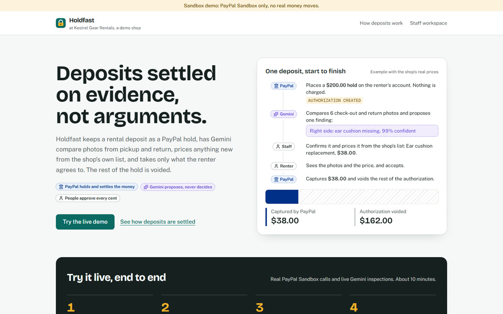
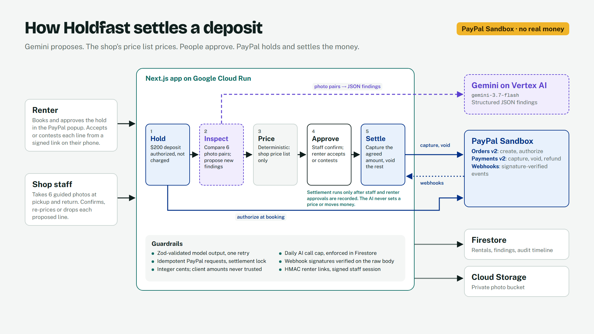
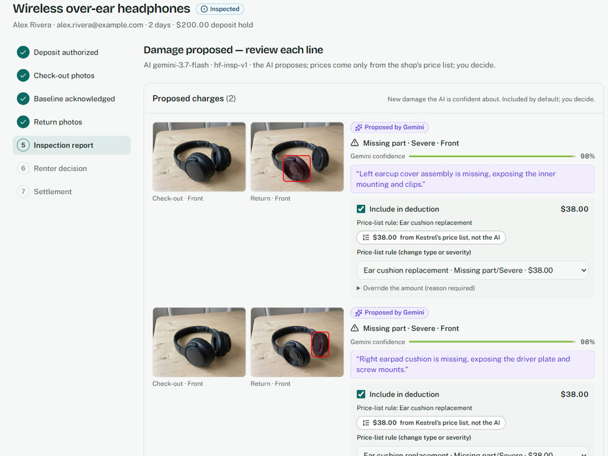
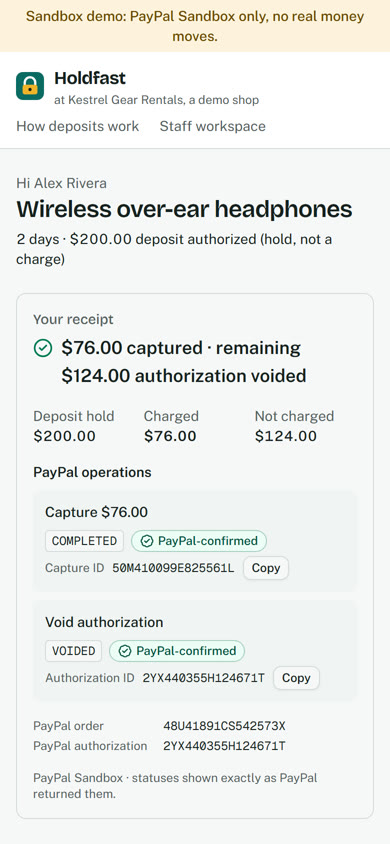
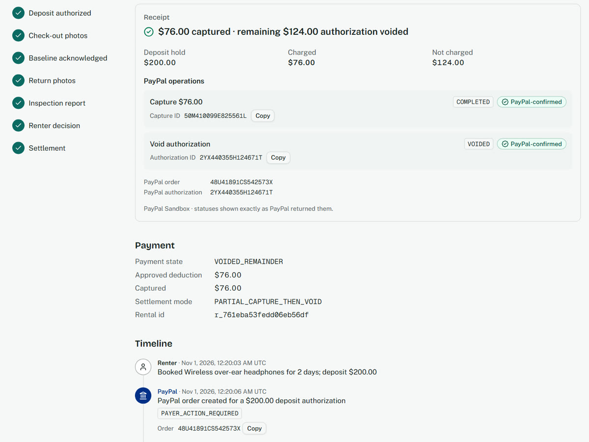
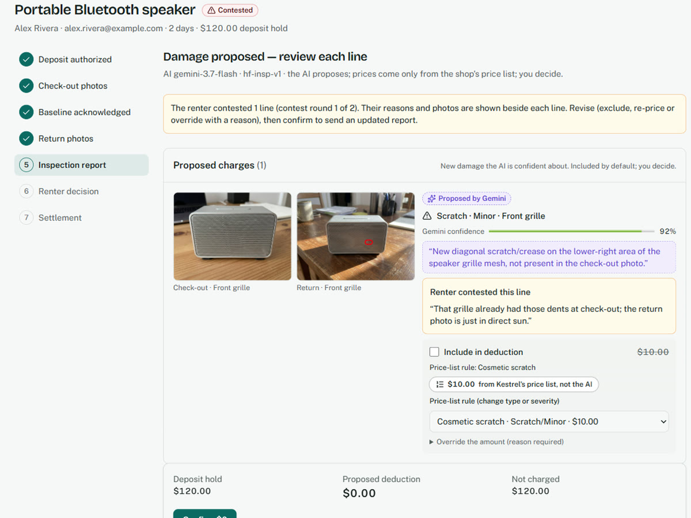

# Holdfast

**Rental deposits settled on evidence, not arguments.**

Holdfast keeps a rental deposit as a PayPal authorization (a hold, not a charge). At pickup and return, staff photograph the item from six angles. Gemini on Vertex AI compares the pairs and proposes what is new. The shop's own price list prices each line, never the AI. Staff confirm, the renter accepts or contests from their phone, and PayPal captures only the agreed amount and voids the rest of the authorization.

Built for the PayPal AI Hackathon 2026. Everything runs in the **PayPal Sandbox: no real money moves.**

- **Live demo:** https://holdfast-806240887939.us-central1.run.app
- **Demo video (2:47):** see the Devpost submission
- **License:** MIT



## How it works



1. **Book.** The renter picks an item and approves a PayPal order with `intent: AUTHORIZE`. The deposit becomes an authorization, `CREATED`, with its own ID and expiry.
2. **Check out.** Staff take six guided photos. Gemini records a baseline of pre-existing wear, and the renter acknowledges it on their link.
3. **Return.** Staff take the same six angles. Gemini compares each pair and returns structured findings: type, severity, location box, confidence and a quoted reason. Findings it marks as pre-existing are not charged.
4. **Price.** A deterministic pricer maps each finding to a rule on the shop's price list. Staff can include, exclude, change the rule, or override with a logged reason.
5. **Decide.** The renter sees every photo and price and accepts, or contests a line with a reason (up to two rounds). Staff review and send an updated report.
6. **Settle.** Only after both approvals are recorded, settlement captures the agreed amount (`final_capture: false`) and voids the remaining authorization. A clean return voids the whole authorization. Each step is confirmed by a signature-verified PayPal webhook, and the receipt shows PayPal's own statuses and IDs.

| Gemini proposes, the price list prices | The renter sees the same receipt |
| --- | --- |
|  |  |

| Settlement receipt with PayPal IDs | A contested line, reviewed and dropped |
| --- | --- |
|  |  |

## How PayPal is used

- **Orders v2:** create an order with `intent: AUTHORIZE`; the buyer approves in the PayPal popup (JS SDK); the server authorizes it.
- **Payments v2:** capture a partial amount with `final_capture: false`, then void the authorization. A clean return is a void only. A fallback mode (capture all, then refund the difference) is implemented but not used.
- **Idempotency:** every write sends a `PayPal-Request-Id` derived from the settlement plan, so a retry returns the same capture instead of a second one.
- **Webhooks:** `PAYMENT.AUTHORIZATION.CREATED`, `PAYMENT.CAPTURE.COMPLETED`, `PAYMENT.AUTHORIZATION.VOIDED` and related events are verified with PayPal's verify-signature API on the raw body before anything is recorded.
- **Not covered by the PayPal agent toolkit:** the toolkit and MCP server expose order and refund tools but not authorize, partial capture or void. Holdfast therefore calls the REST APIs directly.

### Settlement mode and its evidence

`SETTLEMENT_MODE=PARTIAL_CAPTURE_THEN_VOID` was chosen from a sandbox spike run on Oct 27, 2026 (`spike/RESULTS.md`):

| Question | Result |
| --- | --- |
| Partial capture of a PayPal-wallet authorization | Works with no account setting: $38 of $200 → `COMPLETED` |
| Void after `final_capture: false` | `200`, authorization `VOIDED` |
| Void after `final_capture: true` | `422 PREVIOUSLY_CAPTURED`; the auth reports `CAPTURED` |
| Retry with the same `PayPal-Request-Id` | Same capture ID, no duplicate |
| Webhook signatures | All 11 real deliveries verified `SUCCESS` |

The app's wording follows PayPal's statuses: "captured" and "voided". It never calls a void a refund, and it does not claim the voided amount is back in the buyer's balance, because that buyer-side view was not verified.

## How AI is used

- **Model:** `gemini-3.7-flash` on Vertex AI (`@google/genai`, Vertex mode), prompt `hf-insp-v1`, structured JSON output validated with Zod. Invalid output gets one retry, then the angle is marked for a human.
- **Proposes, never decides.** AI output is a list of findings. It never sets a price, and it never starts a payment: only settlement code, after the recorded staff and renter approvals, calls PayPal.
- **Guardrails:** confidence thresholds put uncertain findings under "Needs your eyes", excluded from the deduction unless staff include them; pre-existing wear from the baseline is suppressed; photo quality problems mark an angle unusable rather than guessing; every proposal shows the model, prompt version and its reason.
- **Cost control:** `AI_DAILY_CALL_LIMIT` is enforced in Firestore before every call, and every loop that calls Gemini has a hard bound.
- **Replay mode** (`AI_MODE=replay`) returns only a previously recorded *live* response for byte-identical inputs, and the UI labels it as a replay. It never invents a result.

### Evaluation (`npm run eval`)

Latest run: 8 cases, all **real photos** of the owner's own items, no AI-generated or edited images (`eval/reports/eval-20261030050110.md`).

| Metric | Result |
| --- | --- |
| New damage detected | 3 of 3 |
| Pre-existing wear correctly not charged | 2 of 2 |
| Clean returns with no proposed charge | 4 of 5 |
| **False-charge rate** | **1 of 5** (a six-angle clean return with a changed background; a dent was proposed) |
| Schema-valid output | 24 of 24 calls |
| Latency per angle, p50 / p95 | 4.5 s / 10.7 s |
| Cost of the 24 live calls | about $0.08 |

**Caveat:** 8 cases is far too few for meaningful accuracy rates. Read these as per-case evidence, not as an accuracy claim. The one false charge is exactly why staff confirm every line and the renter can contest it.

## Run it yourself

### Prerequisites

- Node.js 24+ and npm
- A PayPal Developer account (free) for Sandbox credentials
- A Google Cloud project with billing (the Free Trial works) for Firestore, Cloud Storage and Vertex AI
- The `gcloud` CLI

### 1. PayPal Sandbox

1. At developer.paypal.com → **Apps & Credentials**, switch to **Sandbox** and create an app. Copy the client ID and secret.
2. Under **Testing Tools → Sandbox Accounts**, note a **personal** (buyer) account. You sign in with it in the PayPal popup when booking.
3. Webhooks need a public HTTPS URL. After deploying (or with a tunnel), add a webhook at `<APP_BASE_URL>/api/webhooks/paypal` for the payment authorization and capture events, and copy its ID.

### 2. Google Cloud

```bash
gcloud auth login
gcloud config set project <PROJECT_ID>
gcloud services enable firestore.googleapis.com storage.googleapis.com aiplatform.googleapis.com
gcloud firestore databases create --location=us-central1 --type=firestore-native
gcloud storage buckets create gs://<BUCKET> --location=us-central1 \
  --uniform-bucket-level-access --public-access-prevention
gcloud auth application-default login   # local credentials for Firestore, Storage and Vertex AI
```

Firestore asks for one composite index (rentals by `status`, `updatedAt desc`) the first time the staff list loads; its error message links straight to it.

### 3. Configure

```bash
git clone https://github.com/Rudrani26/holdfast.git
cd holdfast
npm ci
cp .env.example .env.local
```

Fill in `.env.local`. Every variable is described in `.env.example`.

| Variable | Value |
| --- | --- |
| `PAYPAL_ENV` | `sandbox` (the app refuses to start otherwise) |
| `PAYPAL_CLIENT_ID`, `NEXT_PUBLIC_PAYPAL_CLIENT_ID`, `PAYPAL_CLIENT_SECRET` | From your sandbox app |
| `PAYPAL_WEBHOOK_ID` | From your webhook (needed for verified badges) |
| `GCP_PROJECT_ID`, `GCS_BUCKET` | Your project and bucket |
| `STAFF_PASSCODE` | Any passcode for the staff workspace |
| `SESSION_SECRET`, `RENTER_LINK_SECRET` | 32+ random bytes each: `node -e "console.log(require('crypto').randomBytes(32).toString('base64url'))"` |

### 4. Seed and run

```bash
npm run seed    # demo shop catalog and price list into Firestore
npm run dev     # http://localhost:3000
```

### 5. Checks

```bash
npm run typecheck && npm run lint && npm test   # unit tests, no network
npm run check:secrets                          # after npm run build: no secrets in the client bundle
npm run test:integration                       # opt-in: real PayPal Sandbox and Vertex AI calls
```

Deploying to Cloud Run: `docs/DEPLOYMENT.md` and `scripts/deploy.md`.

## Demo walkthrough

About 10 minutes on the live demo or a local run. You need a sandbox buyer account and the staff passcode (judges: see the private testing instructions on Devpost).

1. **Book.** On the storefront, choose an item, enter a name and email, and approve the PayPal popup with the sandbox **buyer** account. The confirmation shows the authorization ID, `CREATED`, and your renter link.
2. **Check out.** Open **Staff workspace**, sign in, open the rental, and add the six check-out photos. Run the baseline inspection.
3. **Acknowledge.** Open the renter link (copy it from the staff page) and acknowledge the baseline.
4. **Return.** Back in the staff workspace, add six return photos and run the inspection. Review each proposed line and confirm.
5. **Decide.** On the renter link, accept, or contest a line with a reason. If contested, staff review and confirm again.
6. **Settle.** Settle from the staff page. The receipt shows the capture and the void with PayPal's IDs, and the badges turn "PayPal-confirmed" when the signed webhooks arrive.

Use your own photos of a real object: take the return set with something visibly changed (for example a removed part), or the same object unchanged for a clean return.

## Security

- PayPal Sandbox only, enforced at startup.
- Secrets live in server environment variables locally and in Secret Manager on Cloud Run; a build check fails if any secret reaches the client bundle.
- Every webhook signature is verified with PayPal before it is acted on. Saved PayPal responses are redacted.
- Amounts are integer cents and come only from the price list and staff-approved lines; the server never trusts a client-supplied amount.
- Staff routes need a signed session cookie; renter pages need an HMAC-signed link scoped to one rental.
- Photos live in a private bucket and are served only through authenticated app routes.
- Settlement runs under a Firestore lock with idempotent PayPal requests, so a double click or retry cannot capture twice.

## Limitations

- Sandbox only; no real payments. Authorizations expire (29 days in the sandbox), so rentals are meant to be short.
- What a buyer sees in their PayPal account after a void was not verified, so the app does not claim the remainder was "released".
- The evaluation set is small (8 real cases) and includes one false charge; human confirmation is required by design.
- One demo shop, one staff passcode, English only. Webhooks need a public URL, so verified badges do not appear on a plain local run.
- The AI compares photos; it cannot detect what the photos do not show.

## Third-party licenses

Runtime: Next.js, React, Zod, Radix UI, sonner, next-themes, clsx, tailwind-merge, server-only (MIT); lucide-react (ISC); `@google-cloud/firestore`, `@google-cloud/storage`, `@google/genai`, sharp, class-variance-authority (Apache-2.0). Tooling: TypeScript, Playwright (Apache-2.0); Tailwind CSS, shadcn, ESLint, Vitest, tsx (MIT); dotenv (BSD-2-Clause). Fonts: Public Sans, Bricolage Grotesque, Geist Mono (SIL Open Font License). All photos are the author's own.

## License

MIT, see [LICENSE](LICENSE).
