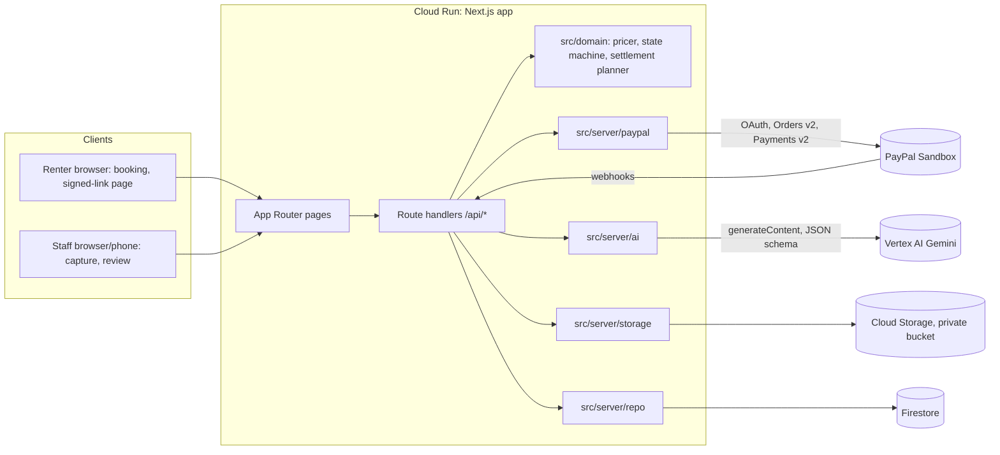

# ARCHITECTURE.md — Holdfast technical design

One Next.js application on Cloud Run, Firestore for state, Cloud Storage for photos, Gemini on Vertex AI for inspection, PayPal Sandbox for money. No other services.

## 1. System diagram



## 2. Components and responsibilities

| Module | Responsibility | Must not |
| --- | --- | --- |
| `src/app/(public)` | Storefront, booking, confirmation, trust page | Hold secrets |
| `src/app/staff/*` | Staff login, rentals list, rental workspace | Call PayPal from the client |
| `src/app/r/[token]` | Renter signed-link page: baseline ack, decision, receipt | Expose other rentals |
| `src/app/api/*` | Route handlers; validate input (Zod); call domain + server modules | Contain business rules inline |
| `src/domain/pricer.ts` | `(findings, priceList, depositCents) → lineItems` deterministic, capped | Call AI or I/O |
| `src/domain/rentalMachine.ts` | Allowed transitions, guards | I/O |
| `src/domain/settlementPlanner.ts` | `(mode, depositCents, deductionCents) → ordered ops` | I/O |
| `src/server/paypal/*` | Token cache, typed REST calls, error mapping, webhook verify | Decide amounts |
| `src/server/settlement.ts` | Executes planned ops with Firestore lock + reconciliation | Run without both approvals recorded |
| `src/server/ai/*` | Image prep, Gemini calls, schema validation, replay store | Set prices or trigger settlement |
| `src/server/storage.ts` | Upload, normalize (`sharp`), signed read URLs | Make bucket public |
| `src/server/repo/*` | `Repo` interface; `FirestoreRepo`, `MemoryRepo` (tests) | Leak Firestore types into domain |
| `src/lib/money.ts` | cents ↔ `"38.00"` | Use floats for money |
| `src/lib/settlementCopy.ts` | Evidence-based wording | Claim unproven releases |
| `src/server/auth.ts` | Staff session cookie (HMAC), renter link tokens | Store passwords |

## 3. Data model (Firestore)

All collections are prefixed with `FIRESTORE_COLLECTION_PREFIX` (e.g. `dev_` locally, empty in the demo deployment). Money is integer cents. Timestamps are Firestore `Timestamp`.

### `items/{itemId}`
```ts
{ name: string; description: string; imagePath: string; // GCS path of hero image
  depositCents: number; dailyRateCents: number; priceListId: string;
  angles: { id: string; label: string; hint: string }[]; // 6 angles, ordered
  active: boolean }
```

### `priceLists/{priceListId}`
```ts
{ name: string; currency: "USD";
  rules: { damageType: DamageType; severity: Severity; amountCents: number; label: string }[] }
```
`DamageType = SCRATCH | SCUFF | CRACK | DENT | CHIP | STAIN | TEAR | MISSING_PART | BROKEN_PART | OTHER`
`Severity = MINOR | MODERATE | SEVERE`

### `rentals/{rentalId}`
```ts
{ itemId: string; renter: { name: string; email: string };
  days: 1 | 2 | 3; depositCents: number;
  status: RentalStatus; paymentState: PaymentState;
  paypal: { orderId?: string; authorizationId?: string; authStatus?: string;
            authExpiresAt?: string; captures: {id:string; amountCents:number; status:string}[];
            refunds: {id:string; amountCents:number; status:string}[]; voided?: boolean };
  settlementMode: SettlementMode;           // copied from env at creation
  baselineAck?: { at: Timestamp; tokenId: string };
  staffConfirmedAt?: Timestamp; renterDecisionAt?: Timestamp;
  approvedDeductionCents?: number; contestRound: number;
  createdAt: Timestamp; updatedAt: Timestamp; version: number }
```

### `rentals/{id}/photos/{phase}_{angleId}`
```ts
{ phase: "CHECKOUT" | "CHECKIN" | "CONTEST"; angleId: string; gcsPath: string; sha256: string;
  width: number; height: number;
  provenance: "LIVE_CAPTURE" | "UPLOADED_REAL" | "UPLOADED_HYBRID" | "UPLOADED_SYNTHETIC";
  createdAt: Timestamp }
```
`provenance` is chosen at upload; anything other than `LIVE_CAPTURE`/`UPLOADED_REAL` shows a disclosure chip in every UI that displays the photo.

### `rentals/{id}/inspections/{inspectionId}`
```ts
{ kind: "BASELINE" | "RETURN" | "RECHECK"; model: string; promptVersion: string;
  mode: "LIVE" | "REPLAY"; status: "OK" | "PARTIAL" | "FAILED";
  perAngle: { angleId: string; usable: boolean; issues: string[]; latencyMs: number;
              noChangeConfidence?: number; rawResponsePath: string; findings: Finding[] }[];
  verdict?: "NO_NEW_DAMAGE" | "NO_CHARGES_PROPOSED_REVIEW" | "DAMAGE_PROPOSED" | "INCOMPLETE"; // RETURN only; computed by src/server/ai/verdict.ts
  tokenUsage?: { input: number; output: number }; createdAt: Timestamp }
```
`Finding` is defined in `docs/AI_PIPELINE.md` §5.

### `rentals/{id}/lineItems/{lineId}`
```ts
{ source: "AI" | "STAFF"; inspectionId?: string; findingId?: string; angleId: string;
  damageType: DamageType; severity: Severity; label: string; amountCents: number;
  priceRuleRef?: string; overrideReason?: string;
  staffDecision: "INCLUDED" | "EXCLUDED"; renterDecision?: "ACCEPTED" | "CONTESTED";
  renterComment?: string; round: number }
```

### `rentals/{id}/events/{eventId}` (append-only audit timeline)
```ts
{ at: Timestamp; actor: "SYSTEM" | "STAFF" | "RENTER" | "AI" | "PAYPAL";
  type: string;   // e.g. DEPOSIT_AUTHORIZED, BASELINE_ACKNOWLEDGED, AI_REPORT_READY,
                  // STAFF_CONFIRMED, RENTER_ACCEPTED, RENTER_CONTESTED, SETTLEMENT_OP_SUCCEEDED,
                  // PAYPAL_WEBHOOK_VERIFIED, SETTLEMENT_FAILED
  summary: string; data: Record<string, unknown> }   // PayPal IDs, statuses; never secrets
```

### `settlements/{idempotencyKey}`
```ts
{ rentalId: string; op: "CAPTURE" | "VOID" | "REFUND"; amountCents?: number;
  requestId: string; status: "PENDING" | "SUCCEEDED" | "FAILED";
  attempts: number; paypalObjectId?: string; paypalStatus?: string; error?: string;
  createdAt: Timestamp; updatedAt: Timestamp }
```

### `webhookEvents/{paypalEventId}`
```ts
{ eventType: string; resourceId: string; verified: boolean; rentalId?: string;
  receivedAt: Timestamp; processedAt?: Timestamp }
```

### `meta/aiUsage_{YYYY-MM-DD}`
`{ calls: number }` — enforced against `AI_DAILY_CALL_LIMIT`.

Indexes: `rentals` by `status` + `updatedAt desc` (staff list). Create via console prompt when Firestore asks; document in `DEPLOYMENT.md`.

## 4. Rental state machine

```
DRAFT ──create order──▶ AWAITING_PAYMENT
AWAITING_PAYMENT ──authorized──▶ AUTHORIZED
AUTHORIZED ──baseline photos + AI baseline──▶ BASELINE_READY
BASELINE_READY ──renter acknowledges──▶ CHECKED_OUT
CHECKED_OUT ──return photos uploaded──▶ RETURNED
RETURNED ──AI return inspection──▶ INSPECTED
INSPECTED ──staff confirms line items──▶ AWAITING_RENTER
AWAITING_RENTER ──renter accepts all──▶ READY_TO_SETTLE
AWAITING_RENTER ──renter contests ≥1──▶ CONTESTED
CONTESTED ──staff revises + confirms──▶ AWAITING_RENTER   (contestRound++ ; max 2 rounds)
CONTESTED ──staff drops all contested lines──▶ AWAITING_RENTER
READY_TO_SETTLE ──settlement ops succeed──▶ SETTLED
READY_TO_SETTLE ──ops fail after retries──▶ SETTLEMENT_FAILED ──staff retry──▶ READY_TO_SETTLE
AUTHORIZED | BASELINE_READY ──staff cancels──▶ CANCELLED (void)
```
Guards (enforced in `rentalMachine.ts`, tested):
- `READY_TO_SETTLE` requires `staffConfirmedAt` and `renterDecisionAt` in the current round, and every included line `ACCEPTED`.
- Settlement amount = sum of included, accepted line items; must be ≤ `depositCents` and ≤ remaining authorization.
- After 2 contest rounds unresolved, staff may settle only the undisputed lines (contested lines excluded) — renter keeps the right to dispute with PayPal; noted on receipt.

Payment state machine: `docs/PAYPAL_INTEGRATION.md` §8.

## 5. API contracts

All bodies validated with Zod; errors return `{ error: { code: string; message: string } }` with proper HTTP status. Staff routes require the `hf_staff` cookie; renter routes require a valid token.

| Method & path | Auth | Request | Response |
| --- | --- | --- | --- |
| `POST /api/staff/login` | none | `{ passcode }` | `204` + cookie; `401` |
| `POST /api/staff/logout` | staff | — | `204` |
| `GET /api/items` | none | — | `{ items: ItemPublic[] }` |
| `POST /api/rentals` | none | `{ itemId, days, renterName, renterEmail }` | `{ rentalId }` |
| `POST /api/paypal/orders` | none (rental must be DRAFT/AWAITING_PAYMENT) | `{ rentalId }` | `{ orderId }` |
| `POST /api/paypal/orders/[orderId]/authorize` | none | `{ rentalId }` | `{ status, authorizationId, expiresAt }` |
| `GET /api/rentals` | staff | `?status=` | `{ rentals: RentalSummary[] }` |
| `GET /api/rentals/[id]` | staff | — | `{ rental, item, photos, inspections, lineItems, events }` |
| `POST /api/rentals/[id]/photos` | staff (renter for CONTEST via token route) | multipart: `phase, angleId, provenance, file` (≤ 10 MB, jpeg/png/heic→jpeg) | `{ photoId, sha256 }` |
| `POST /api/rentals/[id]/inspections` | staff | `{ kind: "BASELINE" \| "RETURN" \| "RECHECK" }` | `{ inspectionId, status }` |
| `PATCH /api/rentals/[id]/line-items/[lineId]` | staff | `{ staffDecision?, priceRuleRef?, overrideAmountCents?, overrideReason? }` | `{ lineItem }` |
| `POST /api/rentals/[id]/line-items` | staff | manual line `{ angleId, damageType, severity, priceRuleRef }` | `{ lineItem }` |
| `POST /api/rentals/[id]/confirm` | staff | `{}` | `{ renterLink }` |
| `POST /api/rentals/[id]/settle` | staff | `{}` | `{ rental, settlementOps }` |
| `POST /api/rentals/[id]/cancel` | staff | `{}` | `{ rental }` |
| `GET /api/r/[token]` | renter token | — | renter view model |
| `POST /api/r/[token]/baseline-ack` | renter token | `{}` | `{ ok: true }` |
| `POST /api/r/[token]/decision` | renter token | `{ decisions: { lineId, decision: "ACCEPTED"\|"CONTESTED", comment? }[] }` | `{ status }` |
| `POST /api/r/[token]/contest-photo` | renter token | multipart `angleId, file` | `{ photoId }` |
| `POST /api/webhooks/paypal` | PayPal signature | raw PayPal event | `200` / `400` |

Settlement trigger: in the demo, staff press **Settle** after the renter accepts (keeps a human on the money path). P1 option: auto-settle immediately on acceptance, behind a flag.

## 6. Authentication and authorization

- **Staff:** single passcode (`STAFF_PASSCODE`) → HttpOnly, Secure, SameSite=Lax cookie `hf_staff` = HMAC-SHA256(`SESSION_SECRET`, `staff|<expiry>`), 12 h expiry. Constant-time compare. Login rate limit: 10 attempts / 15 min per IP (in-memory; acceptable for 1 instance demo).
- **Renter:** link `/r/<token>` where token = base64url(`rentalId.expiry.nonce`) + `.` + HMAC(`RENTER_LINK_SECRET`). 14-day expiry. Token grants access to that rental only.
- No user accounts, no Firebase Auth (explicit exclusion — not needed for the demo, adds setup risk).

## 7. File storage

- Bucket `GCS_BUCKET` in `us-central1`, uniform bucket-level access, public access prevention enforced.
- Path: `rentals/<rentalId>/<phase>/<angleId>-<sha256[0:12]>.jpg`; AI raw responses: `ai/<rentalId>/<inspectionId>/<angleId>.json`; replay store: `ai-replay/<cacheKey>.json`; eval images stay in the repo under `eval/` (small) or `gs://<bucket>/eval/` if large.
- Upload pipeline (`sharp`): auto-rotate from EXIF → strip all metadata → resize long edge 1600 px → JPEG q85 → SHA-256.
- Read via V4 signed URLs, 15-minute expiry, generated server-side.
- Lifecycle rule: delete objects older than 120 days (covers judging through Dec 15).

## 8. Error handling

- Domain errors are typed (`DomainError` with `code`); route handlers map them to 4xx.
- PayPal and Vertex errors are wrapped with the upstream status and issue code, logged without secrets, surfaced to staff with a human message.
- Every failure that affects money creates a timeline event.
- UI shows explicit loading, empty, error and retry states for each async action.

## 9. Reliability and security decisions

| Decision | Reason |
| --- | --- |
| Single service, max 2 instances | Cost ceiling; simple; enough for judging |
| Firestore transactions for status transitions and settlement locks | Prevent double settlement under retries/double clicks |
| Webhooks confirm, not drive | Settlement must not depend on webhook delivery |
| AI outputs schema-validated, retried once, else `NEEDS_HUMAN` | No silent bad data |
| Replay mode keyed by SHA-256 of inputs + prompt version | Reliable recording without fabrication |
| Strict CSP; PayPal SDK domains allow-listed | Reduce XSS risk on payment page |
| `PAYPAL_ENV` must equal `sandbox` | No real money ever |

## 10. Environment variables

| Name | Example | Notes |
| --- | --- | --- |
| `APP_BASE_URL` | `http://localhost:3000` | used in renter links |
| `PAYPAL_ENV` | `sandbox` | app refuses anything else |
| `PAYPAL_CLIENT_ID` / `PAYPAL_CLIENT_SECRET` | — | server only |
| `NEXT_PUBLIC_PAYPAL_CLIENT_ID` | — | same client ID, public |
| `PAYPAL_WEBHOOK_ID` | — | from sandbox app webhook config |
| `SETTLEMENT_MODE` | `PARTIAL_CAPTURE_THEN_VOID` | set from spike results |
| `GCP_PROJECT_ID` | — | |
| `GCP_REGION` | `us-central1` | |
| `FIRESTORE_COLLECTION_PREFIX` | `dev_` | empty in deployment |
| `GCS_BUCKET` | — | |
| `VERTEX_LOCATION` | `us-central1` | or `global` if the pinned model requires it |
| `GEMINI_MODEL` | pinned in T-007 | |
| `IMAGE_EDIT_MODEL` | pinned in T-051 | eval generation only |
| `AI_MODE` | `live` | `live` or `replay` |
| `AI_DAILY_CALL_LIMIT` | `300` | |
| `STAFF_PASSCODE` | — | |
| `SESSION_SECRET` / `RENTER_LINK_SECRET` | 32+ random bytes | |
| `DEMO_BANNER` | `true` | shows "Sandbox demo — no real money" |
